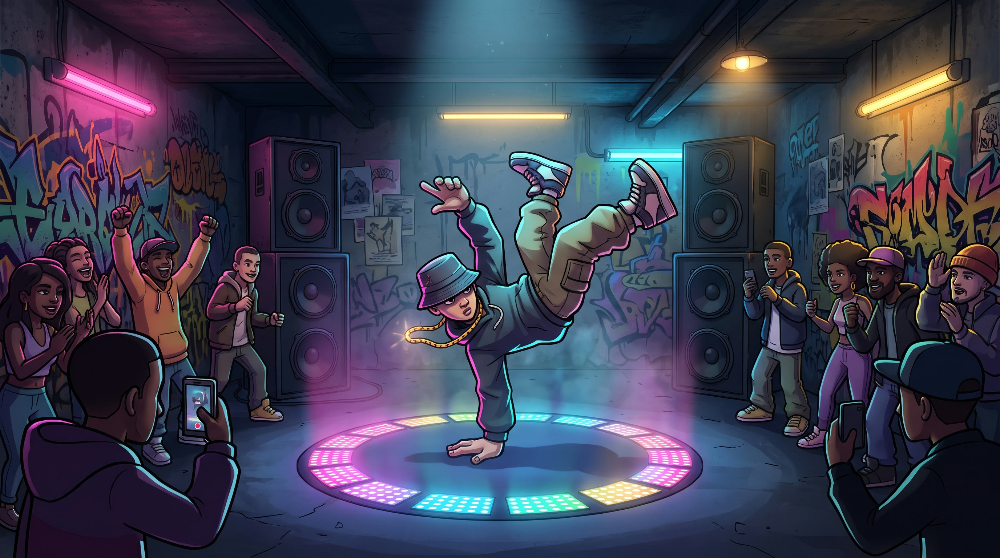

# DANCING BRO

A three.js rhythm-dance game. Land steps and moves on the beat of **any song** (the game finds the beat itself), chain combos, hype up the crowd in an underground graffiti club.

**Play:** https://krishristov33-cloud.github.io/Dancing-Bro/



## Run locally
```bash
npm install
npm run dev      # JSR radio works out of the box (Vite proxies jetsetradio.live)
npm run deploy   # build + publish to the gh-pages branch (live page)
```

## Music sources
- **Practice beat**: built-in, generated in the browser.
- **Your own track**: Load a file or drop an MP3 onto the page.
- **JSR Radio**: jetsetradio.live MP3s. They send no CORS headers, so Web Audio needs a proxy:
  - **Dev:** Vite proxies them automatically.
  - **Hosted page:** deploy `proxy/cloudflare-worker.js` and open the game with `?proxy=https://<worker>.workers.dev`.

## Controls
| Input | Move |
|---|---|
| W / A / S / D | Kick step / side slide / back step |
| Left mouse | Pop hit |
| Right mouse | Arm wave |
| Middle mouse | Chest pop |
| Scroll up / down | Spin / body wave |
| Space | Jump |
| C (hold) | Get low |
| Q / E, Shift+drag, Shift+scroll | Camera |
| M | Metronome on detected beats |
| B | Beat debug strip |
| [ ] | Latency offset |

**Combos:**
- `W S W S`: Running Man
- `A D A D`: Shuffle
- `L R L R`: Pop'n'Lock
- `W A S D`: Helicopter
- `C C Space`: Back Flip
- `↓ ↓ C`: Air Freeze
- `L R ↑ Space`: Tornado
- `M M M M`: Headbanger

See [PLAN.md](PLAN.md) for the full design and roadmap, and [docs/STYLE_PROMPTS.md](docs/STYLE_PROMPTS.md) for the Higgsfield style-lock prompts.
